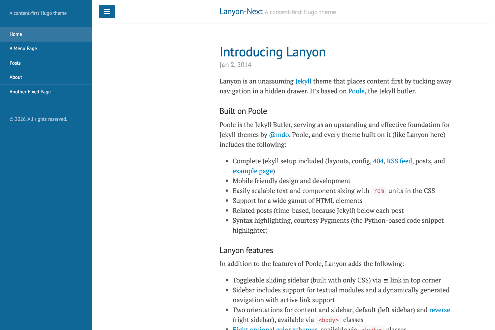

# Lanyon-Next

A content-first blog theme for [Hugo](https://gohugo.io) with a slide-out sidebar.

Lanyon-Next is a maintained continuation of [lanyon-hugo](https://github.com/tummychow/lanyon-hugo), tummychow's Hugo port of [Lanyon](https://github.com/poole/lanyon), the Jekyll theme by Mark Otto. It keeps Lanyon's look and updates everything underneath for current Hugo.



## Features

- Lanyon's original design: a single reading column and a sidebar that toggles with pure CSS, no JavaScript
- Sidebar navigation driven by Hugo's menu system
- One minified, fingerprinted stylesheet
- Meta description, canonical link and OpenGraph tags
- Full-content RSS feed
- Tags and categories on posts
- Version-stamped favicon links, so browsers pick up icon changes
- Optional social links, Disqus comments and Google Analytics

## Requirements

Hugo 0.158.0 or later. The extended edition is not required.

## Installation

### As a git submodule

```bash
git submodule add https://github.com/leeabner/lanyon-next.git themes/lanyon-next
```

Then set the theme in your `hugo.toml`:

```toml
theme = "lanyon-next"
```

### As a Hugo Module

```bash
hugo mod init github.com/<you>/<your-site>
```

```toml
[module]
  [[module.imports]]
    path = "github.com/leeabner/lanyon-next"
```

## Try the example site

```bash
git clone https://github.com/leeabner/lanyon-next.git
cd lanyon-next/exampleSite
hugo server
```

## Configuration

A complete example lives in [`exampleSite/hugo.toml`](exampleSite/hugo.toml).

```toml
baseURL = "https://example.org/"
locale = "en-US"
title = "My Blog"
theme = "lanyon-next"

[params]
  Tagline = "Shown beside the title and in the sidebar"

[[menus.main]]
  name = "Posts"
  pageRef = "/post"
  weight = 10
```

### Parameters

All of these go under `[params]` and all are optional.

| Parameter | What it does | Default |
|---|---|---|
| `Tagline` | Text beside the site title, in the sidebar, and as the fallback meta description | none |
| `description` | Sidebar text (Markdown allowed); replaces the tagline there | `Tagline` |
| `sidebarImage` | Image shown at the top of the sidebar, as a path under `static/` | none |
| `DateForm` | Post date format, in [Go's layout syntax](https://gohugo.io/functions/time/format/) | `Jan 2, 2006` |
| `mainSections` | Sections whose pages appear on the home page and in the feed | Hugo's default |
| `favicon` | Favicon, as a path under `static/` | `assets/favicon.ico` |
| `appleTouchIcon` | Touch icon, as a path under `static/` | none |
| `fontAwesomeKit` | [Font Awesome](https://fontawesome.com) kit ID; needed for icons in social links | none |
| `disableFonts` | Set to `true` to skip loading PT Serif and PT Sans from Google Fonts | `false` |
| `customCSS` | List of extra stylesheets, as paths under `static/` | none |

Hugo's own `copyright` setting replaces the default footer line in the sidebar.

### Sidebar navigation

"Home" is always the first link. The rest come from the `main` menu, in weight order:

```toml
[[menus.main]]
  name = "Posts"
  pageRef = "/post"
  weight = 10
[[menus.main]]
  name = "About"
  pageRef = "/fixed/about"
  weight = 20
[[menus.main]]
  name = "Tags"
  pageRef = "/tags"
  weight = 30
```

A page can also add itself to the sidebar with `sidebar: true` in its front matter. Those links appear after the menu entries, ordered by the page's `weight`.

### Social links

```toml
[params]
  fontAwesomeKit = "your-kit-id"

  [[params.social]]
    name = "GitHub"
    url = "https://github.com/your-name"
    icon = "fa-brands fa-square-github fa-2xl"
```

`icon` is a set of Font Awesome classes. Leave it out to show `name` as a text link instead.

### Comments and analytics

The theme uses Hugo's built-in templates, configured the standard way:

```toml
[services]
  [services.disqus]
    shortname = "your-shortname"
  [services.googleAnalytics]
    id = "G-XXXXXXXXXX"
```

## Content

### Posts

Put posts in a section listed in `mainSections`, for example `content/post/`. They show a date, their tags and categories, and appear on the home page and in the feed.

### Fixed pages

Pages in `content/fixed/` are for standalone content such as an About page. They show a title only, with no date or taxonomy links, and do not appear on the home page.

### Syntax highlighting

`assets/css/syntax.css` styles Hugo's highlighter when it emits classes:

```toml
[markup.highlight]
  noClasses = false
```

To use a different colour scheme, replace the file in your own site's `assets/css/syntax.css` with the output of `hugo gen chromastyles --style=<name>`.

## Customizing the look

The stylesheets are `poole.css`, `syntax.css` and `lanyon.css` in `assets/css`. To change one, copy it to the same path in your own site and edit it there; Hugo uses your copy in place of the theme's. For small additions, use `customCSS`.

The colour themes and layout options described in the [original Lanyon README](https://github.com/poole/lanyon#options) work here as well.

## Credits

- [Lanyon](https://github.com/poole/lanyon) and [Poole](https://github.com/poole/poole) by Mark Otto: the design and CSS
- [lanyon-hugo](https://github.com/tummychow/lanyon-hugo) by Stephen Jung: the original Hugo port

## License

MIT, see [LICENSE.md](LICENSE.md).
